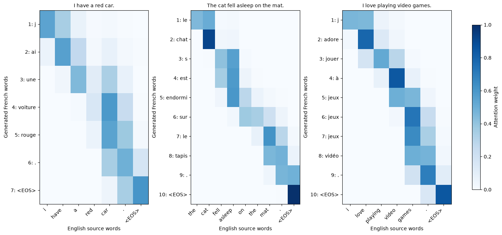

# English-to-French translation with attention

A PyTorch GRU encoder-decoder with concatenation-based global attention. The project studies training behavior, word alignment, and failure modes of greedy translation.

**[Open the notebook](attention_based_translation.ipynb)**

## Method and results

- Single-layer encoder and decoder with 40-dimensional embeddings, 30-dimensional hidden states, and a 20-dimensional attention layer.
- Twenty epochs on preprocessed Tatoeba/ManyThings sentence pairs. Training loss decreased from **5.13 to 2.61** and validation loss from **4.60 to 2.76**.
- Attention visualizations examine adjective/noun order, repeated words, and context-sensitive meanings.

The translation examples below use a **separate reference checkpoint**, not the checkpoint from the recorded training run. The validation split also controls early stopping. No held-out BLEU result or beam-search comparison is claimed.



## Run

From this directory, in a Python 3.11+ environment:

```bash
python -m pip install -r requirements.txt
python -m jupyterlab attention_based_translation.ipynb
```

The notebook downloads the preprocessed data and reference weights from their original host. With `RUN_TRAINING = False`, it loads the reference model for inference. Set it to `True` to train a new checkpoint; a CUDA GPU is recommended. The original epoch summaries are stored separately in `results/training-history.json`.

The baseline uses greedy feedback during training and does not mask padded positions in attention. Padding masks, beam search, and coverage are potential extensions, not completed experiments.
